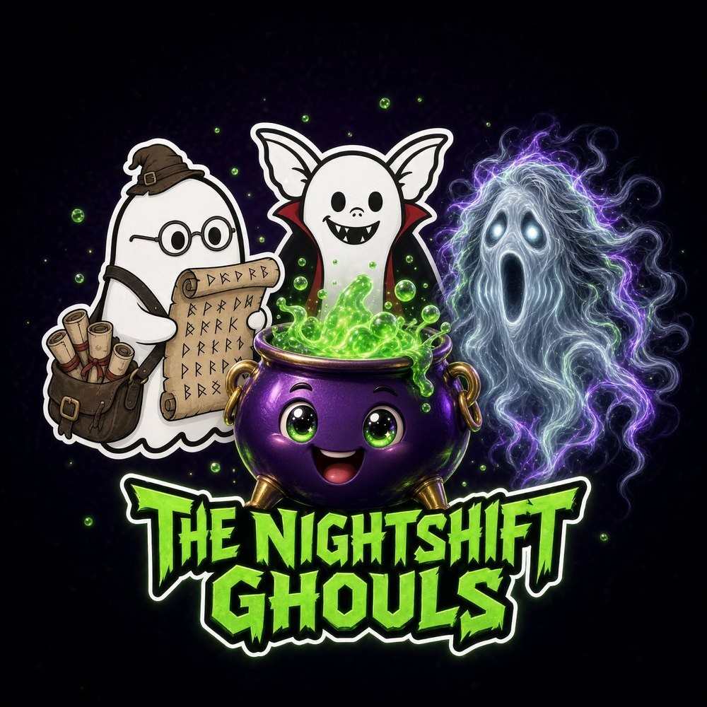

# ghosts-and-goblins

**THE NIGHTSHIFT GHOULS** — the AI bot team roster, a themed fork of Project SAGE.
Eight household agents, one lane each, hard limits enforced, one reporting line
through the Chief of Staff (Count Grokula). No bot moves money or trades; nothing
is sent, paid, or ordered without per-instance human approval.
Built on the static-spa v1.TW engine: zero backend, hash-routed, dark-only,
JetBrains Mono, ecto-green + spectre-violet.

**Pages:** Roster (`#/`) — stat row + eight profile cards (avatar, tagline,
lane, schedule, hard limits, reports) · Doctrine (`#/doctrine`) —
why the team works.

## Configure

Everything you edit lives in **`js/data.js`**:

| What | Where |
|---|---|
| Card content per bot (lane / schedule / limits / reports) | `BOTS` array (mirrors SAGE `docs/dashboard/cards.json`) |
| Why-the-team-works principles | `DOCTRINE` array |
| Masthead / footer text | `SITE` |
| Tag chip colors | `tagColor` in `js/custom.js` |
| Theme colors | `css/style.css` TOKENS block |
| Avatars | `assets/<slug>.jpg` (640px, pre-optimized) |
| Master logo (roster hero + README banner) | `assets/nightshift-ghouls-logo.jpg` |

Preview locally by opening `index.html` in a browser (no server needed —
the roster makes no fetch calls).
